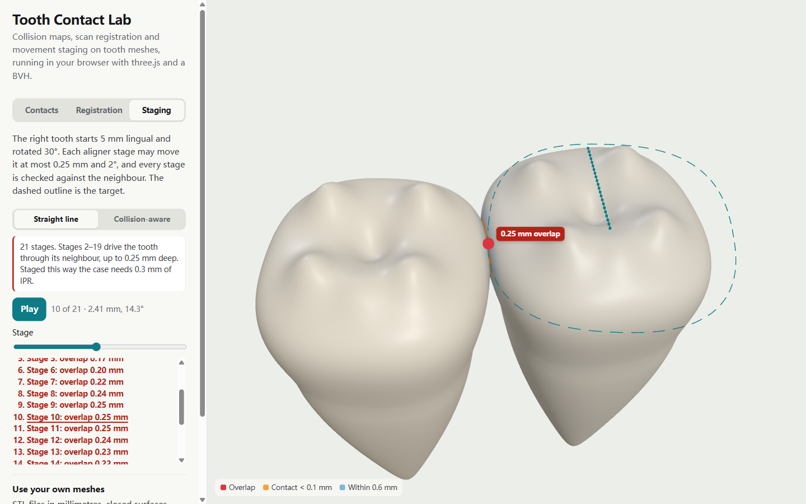
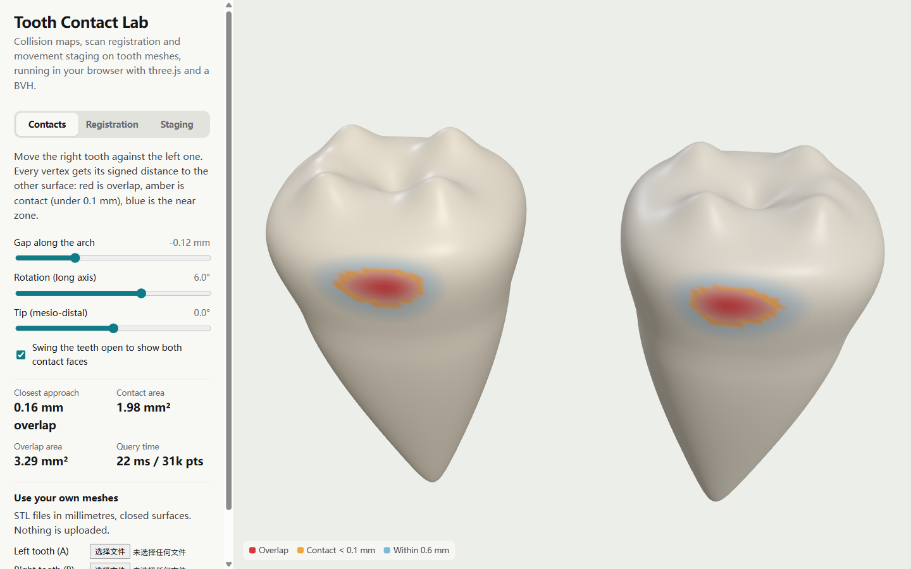
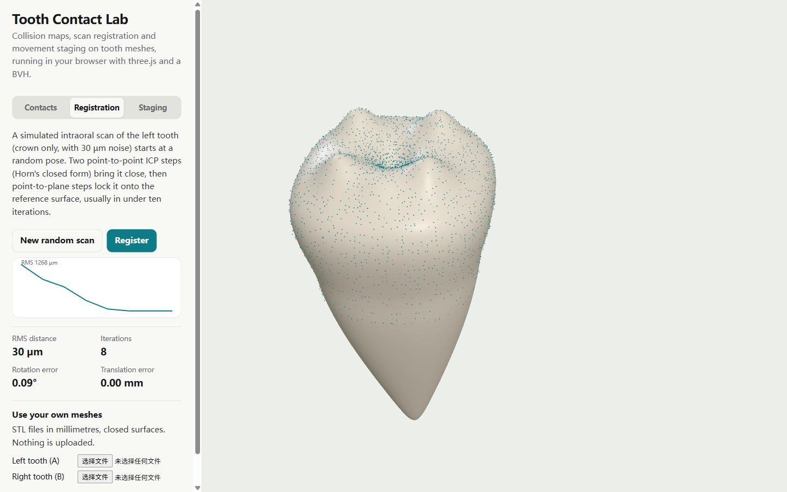

# Tooth Contact Lab

Collision maps, scan registration and aligner staging on tooth meshes, in the browser.

**Live demo:** https://luoy16002-svg.github.io/tooth-contact-lab/



A small, self-contained study of three problems that come up in digital orthodontics software:

1. **Interproximal contacts.** Every vertex of each tooth gets its signed distance to the other tooth's surface. Overlap, contact (under 0.1 mm) and the near zone are painted on the mesh, and contact and overlap areas are summed from per-vertex areas. Both teeth (31k vertices) are measured in about 20 ms on a laptop.
2. **Registration.** A simulated intraoral scan (crown only, 30 µm noise, random 10–18° and 1.6–2.8 mm offset) is aligned to the reference tooth with ICP: two point-to-point steps (Horn's quaternion method) to get close, then point-to-plane steps (linearised, one 6×6 solve each). It converges in 6–8 iterations to under 0.1° and 0.01 mm, with the RMS at the noise floor.
3. **Staging.** A tooth starts 5 mm lingual and rotated 30°, and each stage may move it at most 0.25 mm and 2°. The straight-line plan is checked stage by stage: from stage 2 to 19 it drives the tooth up to 0.25 mm into its neighbour, which would call for 0.3 mm of IPR. The collision-aware plan pushes colliding samples out along the arch and re-times the path to the same limits: 21 stages, none overlapping, no IPR.

You can load your own STL pair (millimetres, closed surfaces). Files stay in the browser.

| Contacts, teeth swung open | Registration |
|---|---|
|  |  |

## How it works

| Piece | File | Notes |
|---|---|---|
| Signed distance | `src/geometry.ts` | `MeshBVH.closestPointToPoint` for every vertex, sign from the normal of the closest face. |
| Contact map | `src/geometry.ts` | Per-vertex area (a third of each adjacent triangle) turns painted vertices into mm². |
| ICP | `src/geometry.ts` | Horn's closed form for the first two iterations, then point-to-plane about the scan centroid. |
| Staging | `src/staging.ts` | `retime` cuts any pose polyline into the fewest stages within both limits; `bentPath` pushes colliding samples along a given direction, then re-times. |
| Procedural molar | `src/tooth.ts` | A welded sphere bent into crown, cusps, fossa and root, so the demo needs no patient data. |

## Limits, and what a production version would change

- The sign comes from the closest face's normal, which can flip next to sharp edges. Angle-weighted pseudo-normals or a winding-number test fix that.
- Stages are checked at their poses only. The swept volume between two stages can still clip a neighbour; a few sub-steps per stage cover it cheaply.
- The planner pushes along one direction (the arch). A real arch has neighbours on both sides, attachments and gingiva, so the push should follow the contact normals of every colliding pair.
- In an Angular app I would keep this core framework-free, wrap the scene in a service, and run the distance queries in a Web Worker (three-mesh-bvh serialises its BVH) so the UI never blocks. The same TypeScript runs under Node for batch checks of a whole case.

## Run it

```bash
npm ci
npm run dev     # local dev server
npm test        # signed distance, ICP convergence, staging limits
npm run build
```

## License

MIT. Built by [Kai](https://luoy16002-svg.github.io/kai-works/).
